# Практична робота № 4

**Тема:** Розроблення REST-ендпоінтів засобами NestJS

---

## Мета роботи

- Опанувати архітектурні засади фреймворку NestJS: модульну організацію, інверсію керування (IoC) та ін'єкцію залежностей (Dependency Injection).
- Навчитися створювати та конфігурувати проєкт за допомогою `@nestjs/cli`, дослідити призначення вхідної точки застосунку `main.ts` та кореневого модуля `AppModule`.
- Опанувати розробку REST-контролерів (`controllers`) із маршрутизацією через декоратори методів (`@Get`, `@Post`, `@Patch`, `@Delete`).
- Навчитися витягувати дані з HTTP-запитів за допомогою декораторів параметрів (`@Param`, `@Query`, `@Body`, `@Headers`) та формувати типізовані контракти DTO (Data Transfer Objects).
- Реалізувати інкапсуляцію бізнес-логіки в сервісному провайдері (`service provider`) з in-memory сховищем та налаштувати коректні HTTP-статуси й виключення (`HttpException`, `NotFoundException`).

---

## Технічне забезпечення

- **Операційна система:** Windows, macOS або Linux.
- **Середовище розробки:** Visual Studio Code (із розширенням REST Client або Thunder Client).
- **Платформа виконання:** Node.js версії 18+ (LTS) та пакетний менеджер npm.
- **Інструменти CLI:** NestJS CLI (`@nestjs/cli`).
- **Інструменти тестування API:** Postman, розширення REST Client (`requests.http`) або утиліта `curl`.
- **Термінал / CLI:** bash, zsh або PowerShell.
- **Система контролю версій:** Git.

---

## Опис проєкту

**Варіант 5 — Онлайн-аптека.** Бекенд інтернет-магазину `online-store` на NestJS: REST API для керування ресурсом **«Ліки»** (`/medicines`) з повним набором CRUD-операцій, query-фільтрацією, типізованими DTO та in-memory сховищем.

### Сутність `Medicine`

| Поле | Тип | Опис |
|---|---|---|
| `id` | `string` | Унікальний ідентифікатор (генерується сервісом) |
| `title` | `string` | Назва препарату |
| `price` | `number` | Ціна |
| `dosageMg` | `number` | Дозування, мг |
| `isPrescriptionRequired` | `boolean` | Чи потрібен рецепт |
| `expirationDate` | `Date` | Термін придатності |

### Ендпоінти

| Метод | Маршрут | Опис | Успішний статус |
|---|---|---|---|
| `GET` | `/medicines` | Список (з підтримкою `?search=` та `?limit=`) | `200 OK` |
| `GET` | `/medicines/:id` | Отримання за ID | `200 OK` / `404 Not Found` |
| `POST` | `/medicines` | Створення | `201 Created` |
| `PATCH` | `/medicines/:id` | Часткове оновлення | `200 OK` |
| `DELETE` | `/medicines/:id` | Видалення | `204 No Content` |

Для `GET /medicines` додатково повертаються службові заголовки відповіді `X-API-Version: 1.0` та `X-Service-Status: operational`.

### Рівень 1. Базовий: створення проєкту та оголошення ендпоінтів

- Проєкт створено через NestJS CLI, згенеровано контролер `medicines`, який автоматично зареєстровано в `AppModule`.
- Створено DTO-класи `CreateMedicineDto` (обов'язкові поля) та `UpdateMedicineDto` (опціональні поля).
- У контролері реалізовано базові методи `@Get()`, `@Get(':id')` (через `@Param('id')`) та `@Post()` (через `@Body()`).

**Генерація контролера**

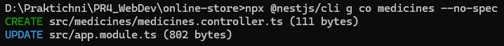

**DTO створення (`CreateMedicineDto`)**

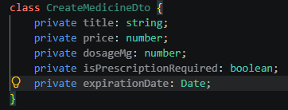

**DTO оновлення (`UpdateMedicineDto`)**

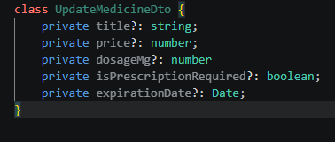

**Базові методи контролера**

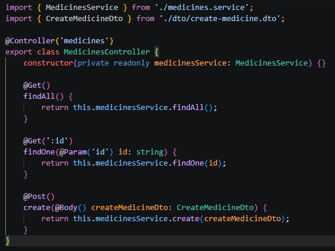

### Рівень 2. Повний REST CRUD, HTTP-статуси та in-memory сервіс

- Через CLI згенеровано сервіс `MedicinesService` із декоратором `@Injectable()`.
- Створено приватне in-memory сховище `items: Medicine[]`, заповнене трьома початковими записами.
- Реалізовано CRUD-методи сервісу (`findAll`, `findOne`, `create`, `update`, `delete`).
- Сервіс впроваджено в контролер через конструктор (Dependency Injection); для `POST` налаштовано статус `201 Created`, для видалення — `204 No Content` (`@HttpCode`).

**Генерація сервісу**

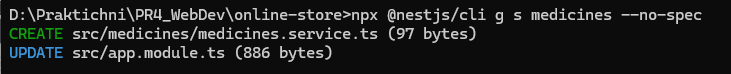

**Інтерфейс `Medicine` та in-memory сховище**

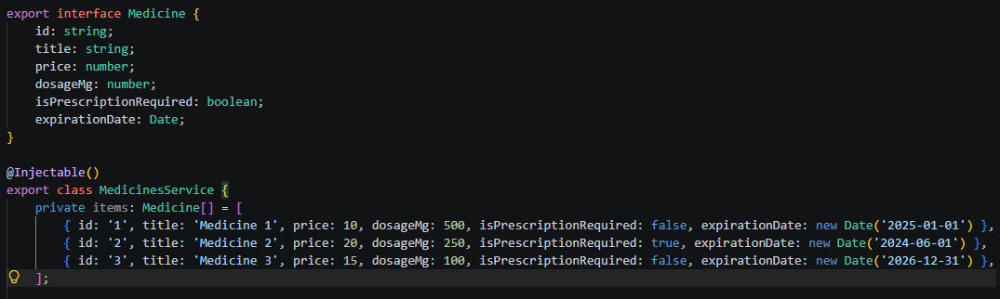

**CRUD-методи сервісу**

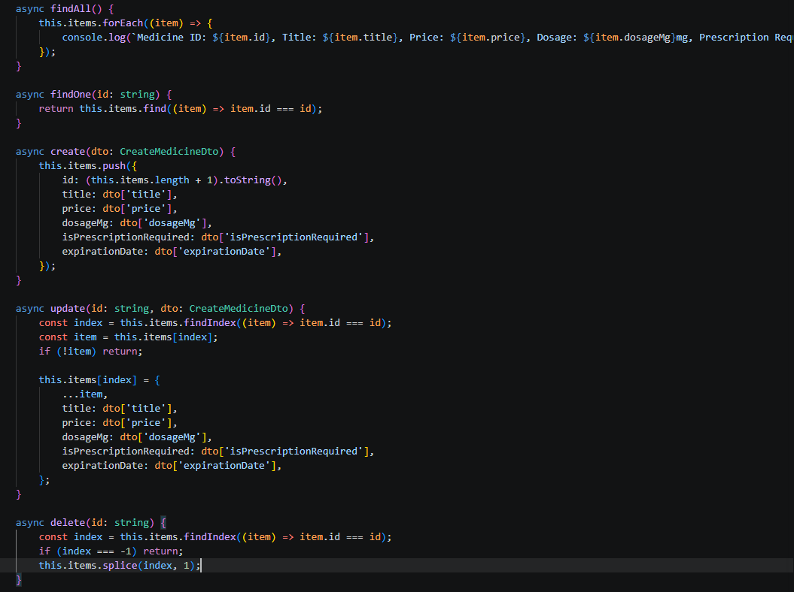

**Контролер із підключеним сервісом**

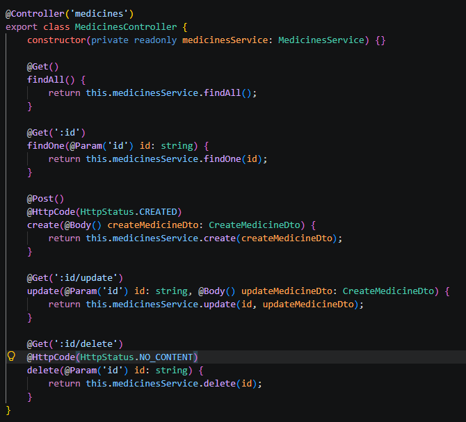

### Рівень 3. Просунутий: query-фільтрація, кастомні Headers та API-тестування

- Метод `@Get()` читає query-параметри `search` (пошук за підрядком у `title` без урахування регістру) та `limit` (обмеження кількості записів).
- За допомогою `@Header()` додано заголовки `X-API-Version` та `X-Service-Status`.
- Створено файл `requests.http` для розширення VS Code REST Client з усіма сценаріями тестування.

**Метод `@Get()` із параметрами та заголовками**

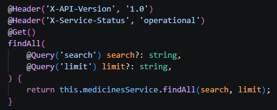

**Логіка фільтрації в сервісі**

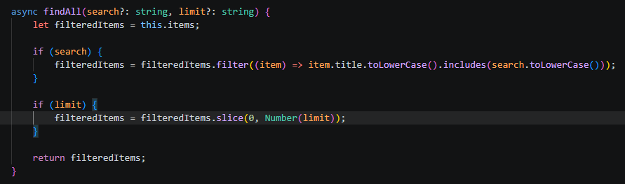

**Файл `requests.http` (початок)**

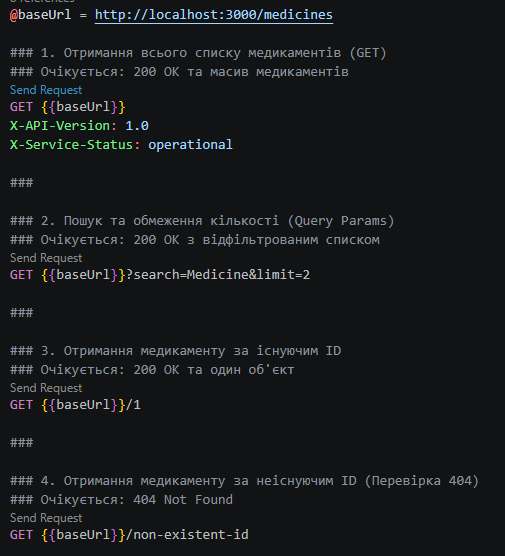

**Файл `requests.http` (продовження)**

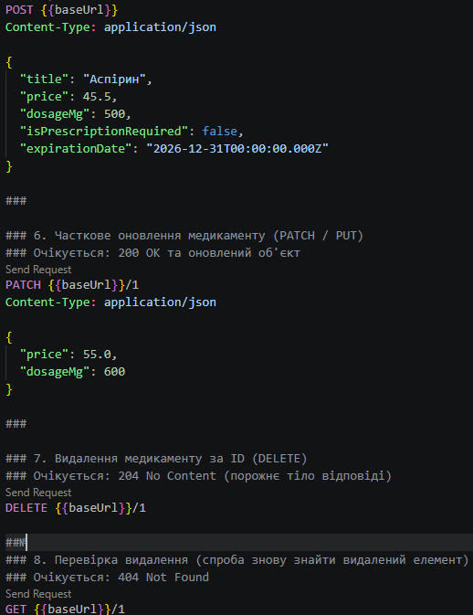

---

## Інструкція запуску

1. Встановіть [Node.js](https://nodejs.org/) версії 18+ (LTS) та перевірте встановлення:

   ```bash
   node -v
   npm -v
   ```

2. Склонуйте репозиторій, встановіть залежності та перейдіть у каталог проєкту:

   ```bash
   git clone <URL_репозиторію>
   cd online-store
   npm install
   ```

   Якщо проєкт створюється з нуля:

   ```bash
   npx @nestjs/cli new online-store --strict --package-manager npm
   cd online-store
   npx @nestjs/cli g co medicines --no-spec
   npx @nestjs/cli g s medicines --no-spec
   ```

3. Запустіть сервер у режимі розробки:

   ```bash
   npm run start:dev
   ```

   Сервер буде доступний за адресою `http://localhost:3000`.

4. Протестуйте API одним зі способів:
   - У VS Code з розширенням **REST Client** відкрийте `requests.http` і натискайте **Send Request** над потрібним запитом.
   - Через `curl`, наприклад:

     ```bash
     curl "http://localhost:3000/medicines?search=Medicine&limit=2"
     ```

---

## Результати тестування API

Усі запити виконано з файлу `requests.http` (змінна `@baseUrl = http://localhost:3000/medicines`).

### 1. Отримання всього списку медикаментів — `200 OK`

У відповіді присутні заголовки `X-API-Version` та `X-Service-Status`.

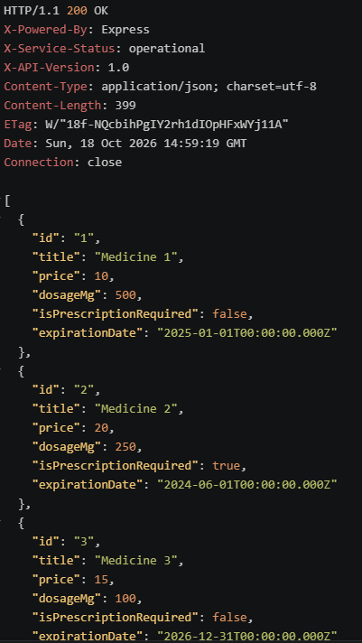

### 2. Пошук та обмеження кількості — `GET /medicines?search=Medicine&limit=2`

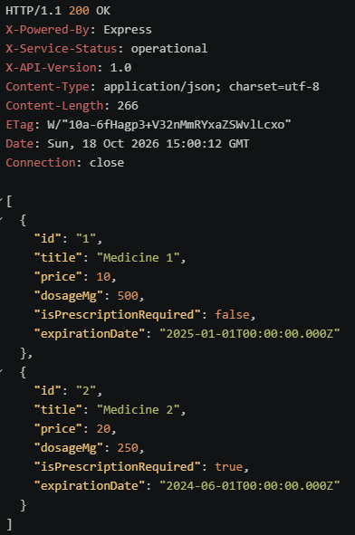

### 3. Отримання медикаменту за існуючим ID — `GET /medicines/1`

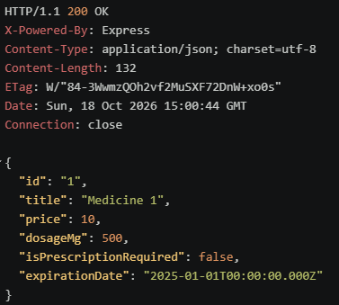

### 4. Отримання за неіснуючим ID — `404 Not Found`

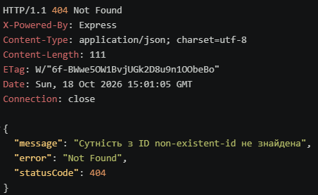

### 5. Створення нового медикаменту — `201 Created`

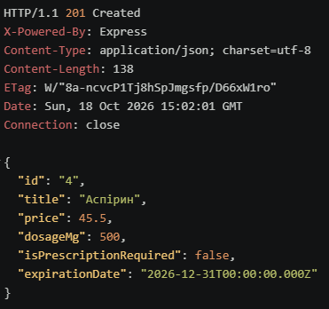

### 6. Часткове оновлення — `PATCH /medicines/1`

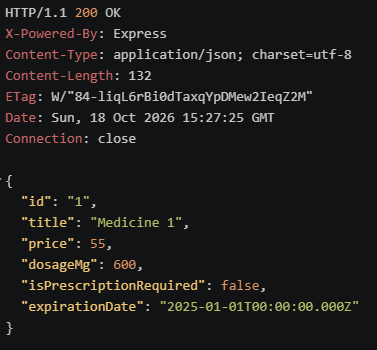

### 7. Видалення за ID — `204 No Content`

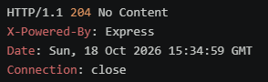

### 8. Перевірка видалення — повторний `GET /medicines/1` → `404 Not Found`

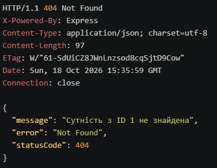

---

## Висновок

У ході виконання практичної роботи було опановано архітектурні засади NestJS, розгорнуто та сконфігуровано проєкт за допомогою `@nestjs/cli`, створено REST-контролер із маршрутизацією `@Get`, `@Post`, `@Patch` та `@Delete`, налаштовано обробку даних через декоратори `@Param`, `@Query`, `@Body`, `@Headers` і типізовані класи DTO, а також реалізовано in-memory сервіс для інкапсуляції бізнес-логіки з належною обробкою HTTP-статусів і виключень `NotFoundException`.
