# Практична робота № 5

**Тема:** Модульна архітектура та ін'єкція залежностей у NestJS

---

## Мета роботи

- Опанувати принципи побудови модульної архітектури серверних додатків на базі NestJS: поділ системи на ізольовані функціональні модулі (feature modules) та спільні утилітарні модулі (shared modules).
- Засвоїти фундаментальні механізми ін'єкції залежностей (Dependency Injection): експорт та імпорт сервісів між модулями через метадані `@Module({ imports, exports })`.
- Навчитися створювати та використовувати кастомні провайдери (custom providers) із застосуванням стратегій `useValue` та `useFactory`, токенів ін'єкції (injection tokens) та декоратора `@Inject()`.
- Опанувати роботу з життєвим циклом компонентів NestJS через хук `OnModuleInit` та керування областями видимості провайдерів (provider scopes).

---

## Технічне забезпечення

- **Операційна система:** Windows, macOS або Linux.
- **Середовище розробки:** Visual Studio Code (з розширенням REST Client або Thunder Client).
- **Платформа виконання:** Node.js версії 18+ (LTS) та пакетний менеджер npm.
- **Інструменти CLI:** NestJS CLI (`@nestjs/cli`).
- **Інструменти тестування API:** Postman, розширення REST Client (`requests.http`) або консольна утиліта `curl`.
- **Термінал / CLI:** bash, zsh або PowerShell.
- **Система контролю версій:** Git.

---

## Опис проєкту

**Варіант 5 — Онлайн-аптека.** Система інтернет-магазину `online-store` реорганізована в модульну архітектуру з трьох модулів:

| Модуль | Тип | Призначення |
|---|---|---|
| `MedicinesModule` | Feature Module | Каталог ліків (`/medicines`): CRUD, пошук, генерація `slug` |
| `OrdersModule` | Feature Module | Замовлення (`/orders`): перевірка наявності товару в каталозі та розрахунок вартості з податком |
| `SharedModule` | Shared Module | Спільні утиліти: `SlugService`, провайдери `STORE_CONFIG`, `FEE_CALCULATOR`, `RequestIdService` |

`AppModule` містить лише імпорти модулів. `MedicinesService` експортується з `MedicinesModule` та впроваджується в `OrdersService` через Dependency Injection.

### Рівень 1. Базовий: ізоляція Feature Module та створення Shared Module

- Через NestJS CLI згенеровано `MedicinesModule` та `SharedModule`.
- Контролер і сервіс ліків перенесено в `MedicinesModule` (`controllers: [MedicinesController]`, `providers: [MedicinesService]`), із кореневого `AppModule` вони прибрані.
- У `SharedModule` згенеровано `SlugService` з методом `generateSlug(title)` (нижній регістр, пробіли → дефіси, очищення від зайвих символів) та експортовано його.
- `SlugService` впроваджено в `MedicinesService` через конструктор; при створенні нового товару поле `slug` генерується автоматично.

**Генерація `MedicinesModule`**

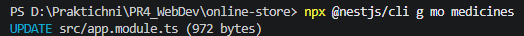

**Генерація `SharedModule` та `SlugService`**

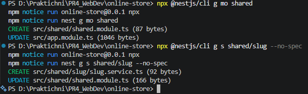

**`MedicinesModule`: контролер і сервіс**

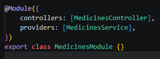

**`AppModule` після рефакторингу**

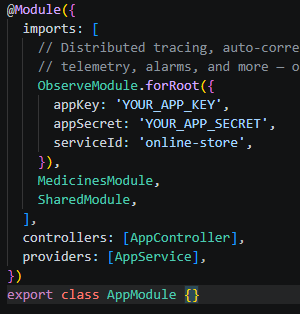

**Метод `generateSlug` у `SlugService`**

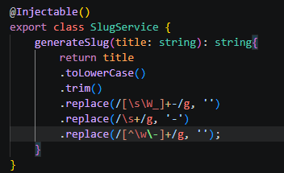

**Ін'єкція `SlugService` у `MedicinesService` та автогенерація `slug` при створенні**

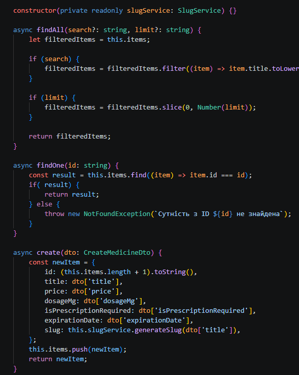

### Рівень 2. Міжмодульна взаємодія та конфігураційні Custom Providers

- Згенеровано `OrdersModule`, `OrdersService` та `OrdersController`; описано `CreateOrderDto` (`productId`, `quantity`).
- `MedicinesService` експортується з `MedicinesModule` та впроваджується в `OrdersService`. Метод `createOrder` перевіряє наявність товару (`NotFoundException`, якщо не знайдено), рахує вартість та зберігає замовлення в in-memory список.
- Custom Provider за стратегією **`useValue`**: токен `STORE_CONFIG` з конфігурацією магазину (`storeName`, `defaultCurrency`, `taxPercent`).
- Custom Provider за стратегією **`useFactory`**: `FEE_CALCULATOR` з методом `calculateTax(amount)`, який отримує `STORE_CONFIG` через `inject: [STORE_CONFIG]`.
- `FEE_CALCULATOR` впроваджено в `OrdersService` через `@Inject(FEE_CALCULATOR)`; податок додається до підсумкової вартості замовлення.

**Генерація `OrdersModule`, `OrdersService` та `OrdersController`**

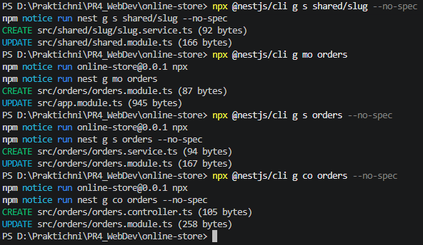

**`CreateOrderDto`**

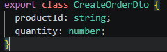

**Створення замовлення (`createOrder`)**

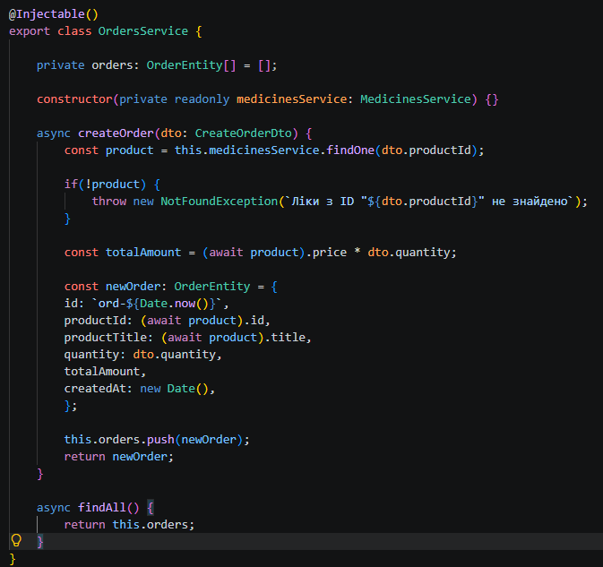

**Custom Provider `useValue` (`STORE_CONFIG`)**

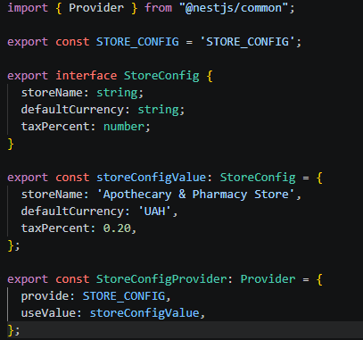

**Custom Provider `useFactory` (`FEE_CALCULATOR`)**

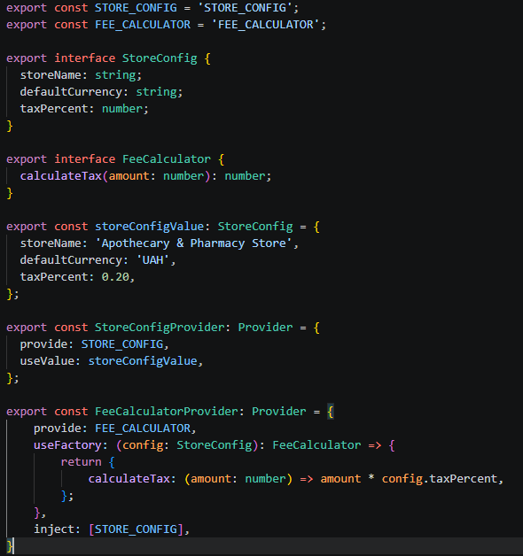

**`FEE_CALCULATOR` у `OrdersService` та додавання податку до вартості**

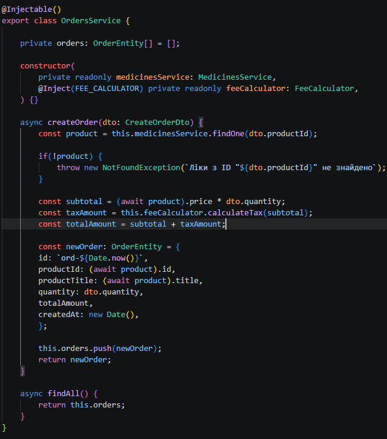

### Рівень 3. Просунутий: Lifecycle Hooks, Scope та комплексне тестування

- `MedicinesService` імплементує `OnModuleInit`: через `Logger` виводить повідомлення про завершення ініціалізації та додає 2 початкові сутності зі згенерованим `slug`.
- `OrdersService` імплементує `OnModuleInit` та виводить повідомлення про готовність до прийому замовлень.
- У `SharedModule` створено `RequestIdService` зі скоупом `Scope.REQUEST`: для кожного HTTP-запиту створюється новий екземпляр із унікальним `requestId`. Сервіс впроваджено в `MedicinesController`.
- Створено `requests.http` для наскрізного тестування модульної екосистеми.

**`MedicinesService` реалізує `OnModuleInit`**

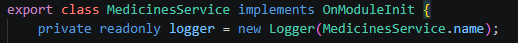

**Метод `onModuleInit()`: повідомлення та початкові дані**

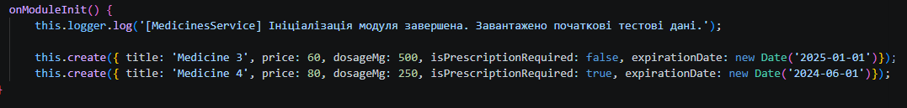

**`OrdersService` реалізує `OnModuleInit`**

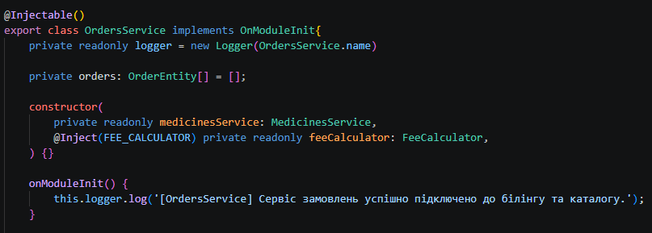

**`RequestIdService` зі скоупом `Scope.REQUEST`**

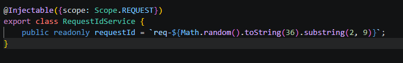

**Ін'єкція `RequestIdService` у `MedicinesController`**

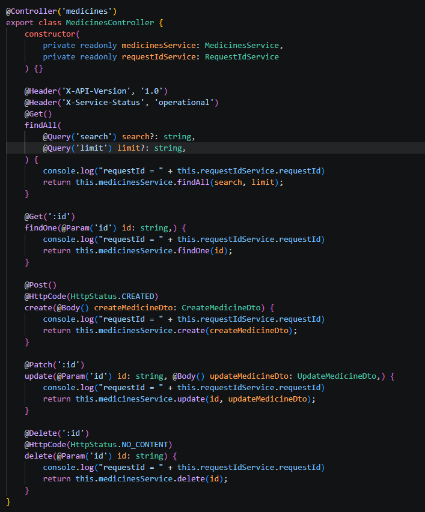

**Файл `requests.http`**

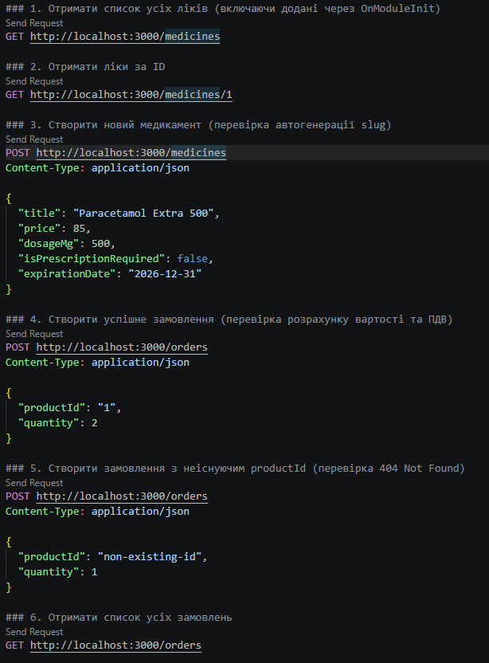

---

## Інструкція запуску

1. Встановіть [Node.js](https://nodejs.org/) версії 18+ (LTS) та перевірте встановлення:

   ```bash
   node -v
   npm -v
   ```

2. Склонуйте репозиторій та встановіть залежності:

   ```bash
   git clone <URL_репозиторію>
   cd online-store
   npm install
   ```

   Якщо модулі створюються з нуля (на базі проєкту з ПР № 4):

   ```bash
   npx @nestjs/cli g mo medicines
   npx @nestjs/cli g mo shared
   npx @nestjs/cli g s shared/slug --no-spec
   npx @nestjs/cli g mo orders
   npx @nestjs/cli g s orders --no-spec
   npx @nestjs/cli g co orders --no-spec
   ```

3. Запустіть сервер у режимі розробки:

   ```bash
   npm run start:dev
   ```

   Сервер буде доступний за адресою `http://localhost:3000`.

4. Протестуйте API: у VS Code з розширенням **REST Client** відкрийте `requests.http` і натискайте **Send Request** над потрібним запитом (або використовуйте `curl`/Postman).

---

## Результати тестування API

Тестування виконано з файлу `requests.http`. Для кожного запиту до `/medicines` у консолі сервера виводиться окремий `requestId` — це підтверджує створення нового екземпляра `RequestIdService` на кожен HTTP-запит (`Scope.REQUEST`).

### 1. Список усіх ліків (включно з доданими через `OnModuleInit`)

Усі записи мають поле `slug`; записи 3 та 4 (`Medicine 3`, `Medicine 4`...) — початкові дані, додані при старті модуля. У відповіді присутні заголовки `X-Service-Status` та `X-API-Version`.

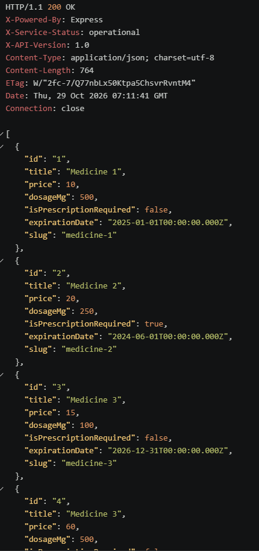

Консоль сервера (унікальний `requestId`):

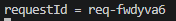

### 2. Отримання ліків за ID — `GET /medicines/1`

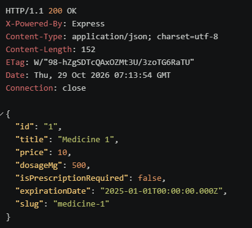

Консоль сервера (інший `requestId`):

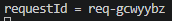

### 3. Створення нового медикаменту — `201 Created`, автогенерація `slug`

Із назви `Paracetamol Extra 500` згенеровано `slug`: `paracetamol-extra-500`.

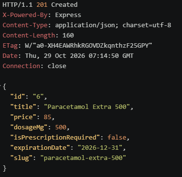

Консоль сервера (ще один `requestId`):

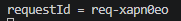

### 4. Успішне замовлення — `POST /orders`, `201 Created`

Ціна одиниці 10 × кількість 2 → `subtotal` = 20; податок 20 % → `taxAmount` = 4; `totalAmount` = 24.

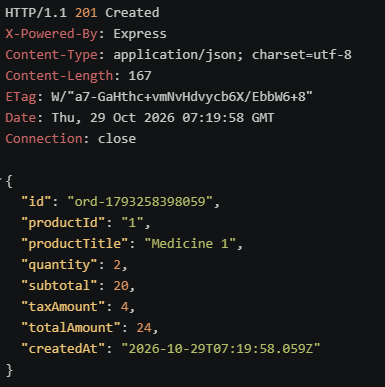

### 5. Замовлення з неіснуючим `productId` — `404 Not Found`

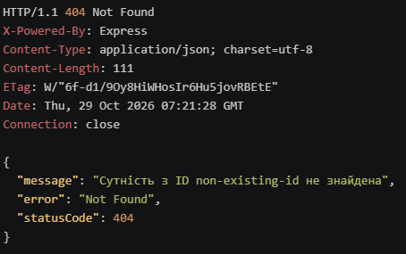

### 6. Список усіх замовлень — `GET /orders`

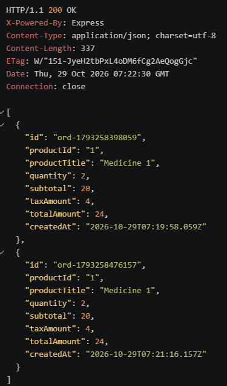

---

## Висновок

У ході виконання практичної роботи реорганізовано застосунок у модульну архітектуру з `MedicinesModule`, `OrdersModule` та `SharedModule`, налаштовано експорт та імпорт сервісів між модулями, створено кастомні провайдери `STORE_CONFIG` (`useValue`) та `FEE_CALCULATOR` (`useFactory`) з ін'єкцією через `@Inject()`, реалізовано ініціалізацію даних через хук `OnModuleInit` та досліджено провайдер зі скоупом `Scope.REQUEST`. Міжмодульну взаємодію протестовано наскрізними запитами з `requests.http`.
